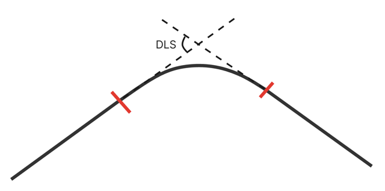
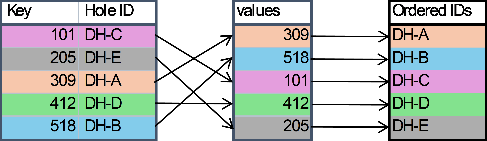
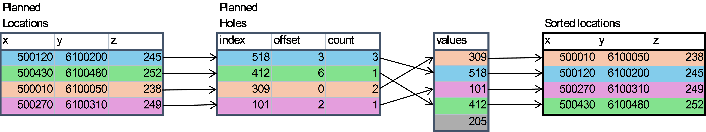
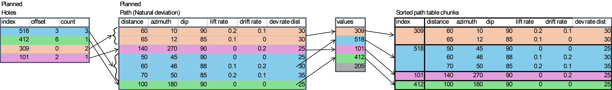
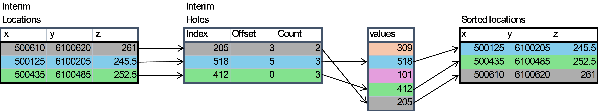
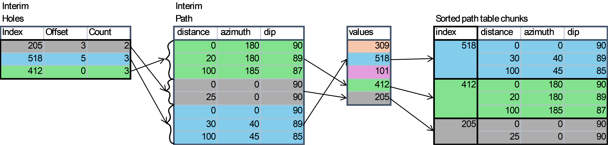
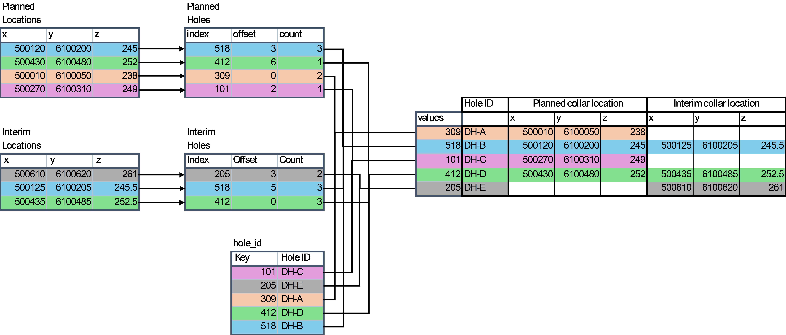

import OverlineWithVersion from '@theme/OverlineWithVersion';
import SchemaUri from '@theme/SchemaUri';
import FlatProperties from '../generated/flatmd/objects/drilling-campaign-1.0.0.md';

<OverlineWithVersion title="Geoscience Objects" version="1.0.0" badge="supported" />

# drilling-campaign

<SchemaUri uri="schema/objects/drilling-campaign/1.0.0/drilling-campaign.schema.json" />

**Key components:**
- [hole-collars](../components/hole-collars.md) — Surface drillhole locations with 3D coordinates and depth
- [desurvey-method](../components/desurvey-method.md) — Algorithm for calculating 3D drillhole paths from survey data
- [downhole-attributes](../components/downhole-attributes.md) — Attributes associated with downhole locations
- [downhole-direction-vector](../components/downhole-direction-vector.md) — Direction and length of downhole segments
- [survey-attribute-definition](../components/survey-attribute-definition.md) — Common properties for survey measurement attributes
- [category-data](../components/category-data.md) — Lookup table mapping integer keys to category names

**See also:** [downhole-collection](downhole-collection.md) (per-hole data), [downhole-intervals](downhole-intervals.md) (interval data).

## Overview

### Objective

This documentation provides a comprehensive guide to the JSON schema for drilling campaign geoscience objects. It is designed to assist both novice and experienced geoscientists in understanding, implementing, and troubleshooting JSON schemas for their drilling data.

### Background

The drilling campaign geoscience object is meant to be used for a set of planned drillholes and their interim drilling results, not necessarily for individual planned drillholes. The purpose of the drilling campaign is to provide a flexible way to organize and store the data across a set of planned drillholes that would be used in production contexts like planning open pit mines, geothermal wells and geotechnical site investigations.

### Scope

- Planned drillholes

### Audience

-  Developers
-  Geoscientists
- Mine planning professionals
- Geotechnical engineers

## Schema structure

The JSON schema for drilling campaign geoscience objects is structured to capture essential data elements relevant to planned drillhole data. Below is a high-level overview of the schema structure:

- Base Object Properties – The root component for all geoscience objects containing common attributes such as name, description, and a unique identifier.
- Base Spatial Data Properties – A set of properties common to all spatial objects such as bounding box and coordinate reference system.
- Planned – Properties relating to the planned drillholes, including the geometry and any expected attributes of the drillholes. The path of a planned drillhole can be defined in different ways depending on the drilling equipment to be used. 
- Interim – Properties relating to interim results from partially or fully drilled holes, including the geometry and any attributes on them. The trajectory of each drillhole in the interim drilling campaign data from the “top” of the hole to the “bottom” of the hole is represented by a series of depth, azimuth, and dip values along the course of the drillhole. This is the raw survey data that is typically used in a desurveying algorithm to compute the geometry of the drillhole in three-dimensional space.
- Metadata – Information about the schema version, data source, units, and other metadata.

The Planned and Interim drilling data have some common properties:
- Location – The geometry of each drillhole in the drilling campaign. Each location is stored as three values whose axis order and meaning are defined by the base `coordinate_reference_system`. The columns are labelled “x”, “y”, and “z”, denoting the first, second, and third CRS axes; for a CRS whose first axis is easting they are (easting, northing, elevation), while for a CRS whose first axis is northing (such as EPSG:2180) they are (northing, easting, elevation). Always interpret the values according to the object's CRS rather than assuming a fixed order. See [Coordinate reference systems and axis order](../../understanding-schemas/coordinate-reference-systems.md).
- Distances – The final, target and current length of the drillhole, measured along the drillhole. These values should be given in the units specified by `distance_unit`.
- Collections – The downhole data stored in a series of related collections. Each collection is made up of attributes that are related to an interval or depth. Collections are analogous to Tables in a database and attributes are analogous to columns in a table.

<FlatProperties />

::mermaid[../generated/uml/drilling-campaign-1.0.0.mmd]

## Schema definitions

NOTE: To keep things simple, only the required properties are defined. For a full list of available properties, refer to the individual component schemas.

### Base spatial data properties

|   Property  |   Value | Example |
| ------------- | ------- | ------- |
|   name      |   The human-readable name of the drilling campaign object. This is the value that users will see when they browse an Evo workspace or list out objects through the Evo API.   | `"Summer 24 Drill Program"` |
|   uuid      |   The universally unique identifier of the drilling campaign object.   |   `dd037871-4279-4954-bd43-3ead9d40a56e`    |
| bounding_box  |   The geographic bounds of the drillhole locations contained in the drilling campaign object. This is used for spatial search in the Evo web portal.   | `{"min_y": 0, "max_y": 10, "min_x": 0, "max_x": 10, "min_z": 0, "max_z": 10}` |
|   coordinate_reference_system |   The coordinate reference system (CRS) that all location data is in. This applies to the bounding box as well as the drillhole locations. See ["Common data types"](https://developer.seequent.com/docs/api/fundamentals/common-data-types/#coordinate-reference-systems) for more information.   |   `{"epsg_code": 32617}` |

## Drilling campaign properties

|   Property  | Value | Example |
| ------------- | ------- | ------- |
|   schema        |  The specific version of the schema that the drilling campaign object will use. This will be used by the Geoscience Object Service to validate the properties of the object.  |   `"/objects/drilling-campaign/1.0.0/drilling-campaign.schema.json"` |
|   type    |  The geoscience object type. For drilling campaign objects, this should be set as campaign.  |  `"campaign"` |
|   distance_unit   |  The unit of measure that all depth values are in. This applies to all depth/from/to values across all collections.  |  `"m"` |
|   hole_id | A category attribute shared by planned and interim drillholes. Its table maps integer keys to hole ID strings, and its `values` array defines the canonical campaign hole order. Other properties reference drillholes using these integer keys. |

### Planned

|   Property  |   Value |
| ------------- | ------- |
|   collar   | The geographic location of each planned drillhole in the drilling campaign. Each location is stored as three float values whose axis order and meaning are defined by the base `coordinate_reference_system`. The columns are named “x”, “y”, and “z”, denoting the first, second, and third CRS axes. Coordinates, distances, holes, and attributes use the same row order within a collar component. Collar data may be out of order, as the order is determined by the index of the hole ID provided in the `holes` table's `index` column. |
|   path    |   The trajectory of each drillhole in the drilling campaign. The columns required depend on the deviation type. The collar `holes` property provides the integer hole ID key and the offset and count of path rows for each drillhole. A hole may have multiple path rows.|
|   collections   | Expected attributes of the planned drillholes at specific depths or depth intervals. Each collection contains a table including the downhole location and value of attributes, and an array indicating which table rows are associated with each planned drillhole.|

#### Planned path (natural deviation)

|   Property  |   Value |
| ----------- | ------- |
| deviation type | The type of deviation used to define the segment geometry. Natural deviation uses lift and drift angles over a set distance to define the dogleg severity of each segment. |
| data | The six columns are `distance` (length of the segment measured along the hole), `azimuth`, `dip` (angle down from horizontal), `lift rate`, `drift rate`, and `deviation rate distance` (the distance over which the given lift and drift rates occur). These parameters define each segment of the planned drillhole. |

#### Planned path (mixed deviation)

|   Property  |   Value |
| ----------- | ------- |
| deviation type | The type of deviation used to define the segment geometry. Mixed deviation uses both natural and directed deviations to define the angle and rate of change of each segment. |
| segment_type | A list to indicate which settings should be used for each segment: either `deviation rate distance`, `lift rate`, and `drift rate` for `"natural"` or `deviation rate distance`, `toolface angle`, and `dogleg severity` for `"directed"`.|
| segment_properties | The columns are `distance` (length of the segment), `azimuth`, `dip` (angle down from horizontal), `deviation rate distance` (The distance over which the given deviation rates occur), `lift rate`, `drift rate`, `toolface angle` (The direction of deviation clockwise from the top side of the drillhole), `dogleg severity` (The total angle change of the segment). These are the parameters that define each segment of the planned drillhole. |

### Interim

The properties of interim drilling data are substantially the same as those of planned drillholes, with the only difference being the path description and choice of desurvey method.

|   Property  |   Value |
| ------------- | ------- |
|   collar |  The geographic location of each interim drillhole in the drilling campaign. Each location is stored as three float values whose axis order and meaning are defined by the base `coordinate_reference_system`. The columns are named `x`, `y`, and `z`, denoting the first, second, and third CRS axes. Coordinates, distances, and attributes use the same row order within a collar component; the collar's `holes` table associates each row with the integer key used by the shared campaign `hole_id` lookup. Not all hole IDs are required to have interim data. The locations may differ from a matching planned hole to reflect where the actual collar was drilled. |
|   path    |   The trajectory of each drillhole in the drilling campaign. The columns are `distance` (measured downhole distance), `azimuth`, and `dip` (angle down from horizontal). This is the raw downhole survey data. The collar `holes` property provides the integer hole ID key and the offset and count of path rows for each drillhole.|
|   desurvey   | The optional desurvey method used to calculate the drillhole geometry. Available options are `minimum_curvature`, `balanced_tangent` and `trench`. |
|   collections   | Attributes of the interim drillholes at specific depths or depth intervals. Each collection contains a table including the downhole location and value of attributes, and an array indicating which table rows are associated with each interim drillhole.|

### Collar
| Property | Value |
| ------------- | ------- |
|   locations | The geographic location of each drillhole in the drilling campaign. Each location is stored as three float values whose axis order and meaning are defined by the base `coordinate_reference_system` (for example, for a CRS whose first axis is northing, they are northing, easting, elevation). The coordinates array has 3 columns named `x`, `y`, and `z`, denoting the first, second, and third CRS axes. Coordinate rows use the same order as the collar `holes` rows; each row's integer key associates that location with a drillhole through the `hole_id` lookup. |
|   distances   | The total depth values of each drillhole in the drilling campaign. The columns are `final`, `target`, and `current`. Each depth is a float, and distance rows use the same order as the collar `holes` rows so the integer key identifies the corresponding hole through the `hole_id` lookup. |
|   holes   | The integer hole ID key, row offset, and count for each drillhole's path data. The first column stores the key used by the `hole_id` category lookup. The offset is the starting path row and the count is the number of path rows for that drillhole. |

## Using the path properties to reconstruct hole geometry

### Planned hole geometry
Planned holes are defined by a series of segments, each with a length and initial orientation. Each segment may also include deviation properties that define how the segment changes over its length, producing a 3D path for each hole. The segments are stored in a single array, and each hole's segments are identified by the offset and count in the collar's `holes` table.

There are two types of planned path table structures: natural deviation and mixed deviation. Natural deviation tables contain only naturally deviated segments where lift and drift rates define how the path changes over each segment. Mixed deviation allows for both natural and directed deviation segments, where directed segments use toolface angle and dogleg severity to define the change in orientation.

#### Natural deviation segments
Segments with natural deviation form a spiral arc in 3D space, with the lift and drift rates defining the change in azimuth and dip over the segment length. The `azimuth` and `dip` derivatives `A'(s)` and `D'(s)` are defined by the lift and drift rates, and the change in azimuth and dip over the segment length is given by integrating these derivatives over the segment length. As such: `A'(s) = drift/(deviation rate distance)` and `D'(s) = -lift/(deviation rate distance)`. The azimuth and dip over the segment length are then given by `A(s) = A0 + ∫A'(s) ds` and `D(s) = D0 + ∫D'(s) ds`, where `A0` and `D0` are the initial azimuth and dip at the start of the segment.

#### Directed deviation segments
Segments with directed deviation form a flat, circular arc in a 2D plane embedded in 3D space. The hole orientation and toolface angle define the plane, and the dogleg severity controls curvature.
The curvature plane is defined by the start vector of the current segment, the perpendicular vector given by the toolface angle and the end location of the previous segment. The segment then forms an arc in that plane, defined by the length of the arc and the angle between the start and end vectors, the dogleg severity. 

### Interim hole geometry
Interim holes are defined by a series of survey points, each with a downhole distance, azimuth, and dip. The survey points are stored in a single array, and each hole's points are identified by the offset and count in the collar's `holes` table. The survey points are used to calculate the 3D geometry of the hole using a desurvey method, which can be one of `minimum_curvature`, `balanced_tangent`, or `trench`. The desurvey method defines how the 3D geometry is calculated from the survey points and can affect the final geometry of the hole.

Consecutive survey stations define the ends of an interval. The selected desurvey method uses the measured-distance difference and the station orientations to reconstruct the geometry between them.

## Example drilling-campaign with both planned and interim drillholes

This example shows how planned and interim drillholes relate to the shared `hole_id` lookup. It has five distinct drillholes: four with planned data, three with interim data, including two IDs that appear in both sections. The integer keys are deliberately not in name order and are not zero-based; use the lookup to resolve them to hole IDs.

The `hole_id` lookup maps integer keys to names, while its `values` array prescribes the canonical order of drillholes across the campaign.

Coordinate and distance rows are associated with hole keys by the corresponding rows in each collar's `holes` table, rather than assuming that the raw storage order matches the campaign hole order. Within each collar component, a `holes` row identifies the collar row by its row position and gives the key and the path slice for that hole. Resolving these keys against `hole_id.values` allows consumers to reconstruct the planned collars, interim collars, and paths in the prescribed campaign order, even though the raw data arrays may be stored in different orders.

Coordinates below are `(x, y, z)` in the object's CRS. See [Coordinate reference systems and axis order](../../understanding-schemas/coordinate-reference-systems.md). Distances are `(final, target, current)` in the unit specified by `distance_unit`.

### Planned collar rows and holes

The planned collar rows are ordered DH-B, DH-D, DH-A, DH-C, which differs from the `hole_id.values` order.

The `holes` rows correspond positionally to the planned collar rows. Their keys identify the holes, and their offsets and counts select the matching ranges from the path array.

### Planned path

These natural-deviation path rows are stored in a different order: DH-A, DH-C, DH-B, DH-D. The first path row for each hole defines its initial collar attitude; this example does not add a separate zero-distance row.

For example, planned collar row 0 is key 518 (DH-B); its path starts at row 3 and contains 3 rows (rows 3–5). Planned collar row 2 is key 309 (DH-A); its path starts at row 0 and contains 2 rows (rows 0–1). The dip convention is positive down.

#### Planned path (mixed deviation alternative)

When drillholes combine straight or freely drifting intervals with motor-steered or wedged sections, the path uses `mixed` deviation. Instead of a single 6-column array, mixed deviation provides two parallel arrays:
- `segment_type`: A string array (`"natural"` or `"directed"`) defining the steering mode for each row.
- `segment_properties`: An 8-column float array containing: `distance`, `azimuth`, `dip`, `lift rate`, `drift rate`, `deviation rate distance`, `toolface angle`, and `dogleg severity`.

Each row in `segment_properties` is interpreted according to the corresponding entry in `segment_type`.

For `"natural"` segments, `lift rate` and `drift rate` govern trajectory change over `deviation rate distance` (leaving `toolface angle` and `dogleg severity` at zero). For `"directed"` segments, the tool is steered using `toolface angle` (clockwise from the high side of the hole) and `dogleg severity` over `deviation rate distance` (leaving lift and drift rates at zero).

For example, DH-B (rows 3–5) starts with an unsteered top segment (row 3, `natural`), then executes two build-and-turn steering runs (rows 4–5, `directed`) using toolface angles of 135° and 90° with dogleg severities of 3.5°/30 m and 4.0°/30 m. The collar `holes` offset (`3`) and count (`3`) index into `segment_type` and `segment_properties` identically to natural deviation paths.

### Interim collar rows and holes

The interim collar rows are ordered DH-E, DH-B, DH-D. DH-B and DH-D are also present in the planned section; DH-E is interim-only.

### Interim path

Interim surveys include a distance-zero row for each hole to record its collar attitude. These rows are part of the path count and offsets.

For example, interim collar row 0 is key 205 (DH-E); its path starts at row 3 and contains 2 rows (rows 3–4), including the distance-zero survey. Interim collar row 2 is key 412 (DH-D); its path starts at row 0 and contains 3 rows (rows 0–2). Expand each section independently by resolving the key from its `holes` row, then selecting that row's path offset and count. Do not infer hole identity from the order of path rows or from the position of the key in `hole_id.values`.

### How planned and interim holes align

Planned and interim sections use the same campaign-level `hole_id` lookup. Matching integer keys identify the same drillhole across both sections; each section's collar row and path slice are still interpreted independently. An ID may occur in either section or both, and its interim collar may differ from its planned collar to reflect the drilled location.

Thus DH-B and DH-D are the two holes with both planned and interim data. DH-A and DH-C have planned data only, and DH-E has interim data only. The `hole_id.values` array prescribes the canonical order of drillholes across the campaign, allowing downstream consumers to align and present planned and interim data in a unified, consistent sequence regardless of raw storage row order.

### Collections

The main result collections to choose from are “interval” and “distance”. The difference between them is whether the data is based on a from/to (interval) or a single depth (distance) value.

NOTE: There are other collection options for specific scenarios (e.g. structures), but these will not be described here. Please refer to the schema for additional information on the other collection types.

Both the interval and distance collections are made up of 3 main components:

- The from-to interval values (for interval) OR the distance values (for distance)
- The attributes (the columns) related to the intervals/depths
- The index/offset/counts, like the path, that provides the instructions how to parse out the data and link it to the drillholes in the campaign

## Troubleshooting common validation errors
Common validation errors and their solutions:

- Error: "Required field missing" - Ensure that all required fields are present in the JSON object.
- Error: "Invalid data type" - Check that the data types of the fields match the schema definition.
- Error: "Out of range value" - Verify that numerical values are within the acceptable range defined in the schema.

## Glossary of key terms

- JSON - JavaScript Object Notation, a lightweight data interchange format.
- Schema - A structured framework for defining the format and content of data.
- Geoscience - The scientific study of the Earth, including its composition, structure, and processes.
- Component
- Element
- Object
- Spatial Object
- Bounding Box
- Coordinate Reference System (CRS)
- Parquet File
